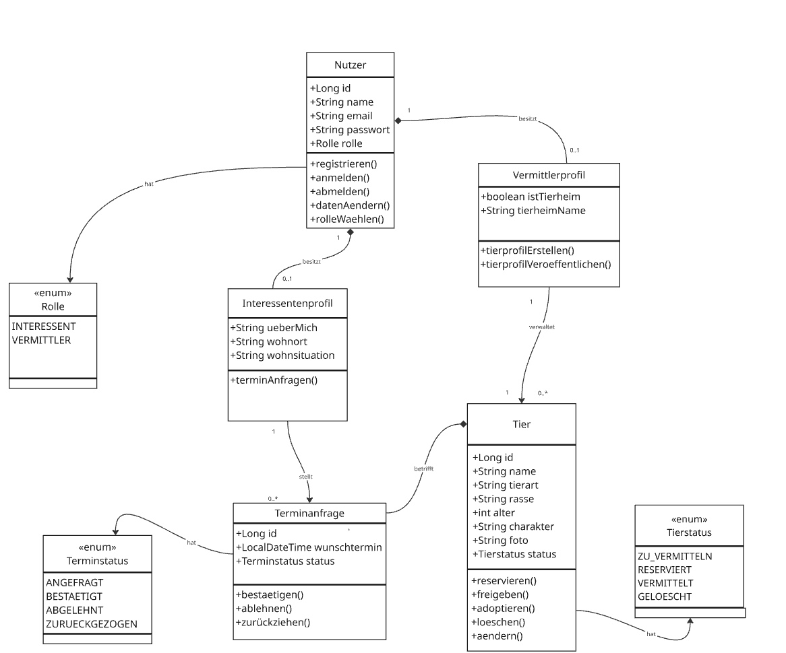

#  PetMatch (Übungsblatt 3 Systemarchitektur Ihres Projektes modellieren)

## Aufgabe 2:

## Klassendiagramm

## Von Events zum Modell

| Event (Miro)                                     | Im Modell                                                                                                                                                                        |
|--------------------------------------------------|----------------------------------------------------------------------------------------------------------------------------------------------------------------------------------|
| Nutzer hat sich registriert                      | `Nutzer.registrieren()`                                                                                                                                                          |
| Interessent hat Profil mit Daten gefüllt         | `Interessentenprofil` (ueberMich, wohnort, wohnsituation)                                                                                                                        |
| Tierprofil wurde erstellt                        | `Vermittlerprofil.tierprofilErstellen()` → neues `Tier` mit Status `ZU_VERMITTELN`                                                                                               |
| Termin wurde angefragt                           | `Interessentenprofil.terminAnfragen()` → neue `Terminanfrage` mit Status `ANGEFRAGT`                                                                                             |
| Termin wurde bestätigt                           | `Terminanfrage.bestaetigen()` → Status `BESTAETIGT`                                                                                                                              |
| Termin wurde abgelehnt                           | `Terminanfrage.ablehnen()` → Status `ABGELEHNT`                                                                                                                                  |
| Tier wurde reserviert und aus der Suche entfernt | `Tier.reservieren()` → Status `RESERVIERT`                                                                                                                                       |
| Tier wurde nicht adoptiert                       | `Tier.freigeben()` → zurück zu `ZU_VERMITTELN`                                                                                                                                   |
| Tier wurde adoptiert                             | `Tier.adoptieren()` → Status `VERMITTELT`                                                                                                                                        |
| Inserat wurde gelöscht                           | `Tier.loeschen()` → Status `GELOESCHT`                                                                                                                                           |
| Termin hat stattgefunden                         | kein eigener Status nötig, weil die Kommunikation nicht im System stattfindet. Danach folgt „adoptiert“ → `VERMITTELT` oder „nicht adoptiert“ → `freigeben()` → `ZU_VERMITTELN` |

## Entitäten, Werte und Aggregate

**Entitäten**
- `Nutzer`: wird registriert, meldet sich an und ab, ändert seine Daten, wählt eine Rolle
- `Tier`: wird eingestellt, geändert, reserviert, freigegeben, vermittelt oder gelöscht
- `Terminanfrage`: wird angefragt, bestätigt, abgelehnt oder zurückgezogen

**Value Objects** 
- Beim Tier: `name`, `tierart`, `rasse`, `alter`, `charakter`, `foto`, `status` (`TierStatus`)
- Beim Nutzer: `name`, `email`, `passwort`, `rolle` (`Rolle`), `Interessentenprofil` (ueberMich, wohnort, wohnsituation), `Vermittlerprofil` (istTierheim, tierheimName)
- Bei der Terminanfrage: `wunschtermin`, `status` (`TerminStatus`)

**Aggregate** 
- Aggregat **Nutzer**: Root `Nutzer` mit Rolle und Profil
- Aggregat **Tier**: Root `Tier` mit seinen Eigenschaften und seinem Status
- Aggregat **Terminanfrage**: Root `Terminanfrage` mit Wunschtermin und Status.

## Aufgabe 3_Bounded Contexts

| Bounded Context | Verantwortung | Entity / Aggregat |
|---|---|---|
| Nutzerverwaltung | Registrierung, An- und Abmeldung, Rolle, Profil füllen | `Nutzer` mit Profil |
| Tierverwaltung | Tiere einstellen, ändern und Status verwalten | `Tier` |
| Terminvermittlung | Termine anfragen, zurückziehen und Status verwalten | `Terminanfrage` |

## Aufgabe 4

### Nutzerverwaltung

**Nutzer** (Aggregat-Root)
- Attribute: id (Long), name (String), email (String), passwort (String), rolle (Rolle)
- Dazu je nach Rolle höchstens ein Profil (0..1):
    - Interessentenprofil: ueberMich, wohnort, wohnsituation (alles String)
        - terminAnfragen(): stellt eine neue Terminanfrage für ein Tier
    - Vermittlerprofil: istTierheim (boolean), tierheimName (String)
        - tierprofilErstellen(): legt ein neues Tier an
        - tierprofilVeroeffentlichen(): macht das Tierprofil für Interessenten sichtbar
- Methoden:
    - registrieren(): erstellt den Nutzer
    - anmelden() / abmelden(): Sitzung starten bzw. beenden
    - datenAendern(): Nutzerdaten bearbeiten
    - rolleWaehlen(): Rolle festlegen (`INTERESSENT` oder `VERMITTLER`)

### Tierverwaltung

**Tier** (Aggregat-Root)
- Attribute: id (Long), name, tierart, rasse, charakter, foto (alles String), alter (int), status (TierStatus)
- Status (`TierStatus`): `ZU_VERMITTELN`, `RESERVIERT`, `VERMITTELT`, `GELOESCHT`
- Methoden:
    - reservieren(): nur wenn das Tier zu vermitteln ist → `RESERVIERT`
    - freigeben(): reserviertes Tier wurde nicht adoptiert → wieder `ZU_VERMITTELN`
    - adoptieren(): nur wenn das Tier reserviert ist → `VERMITTELT`
    - loeschen(): Inserat wird gelöscht → `GELOESCHT`
    - aendern(): Tierprofil bearbeiten

### Terminvermittlung

**Terminanfrage** (Aggregat-Root)
- Attribute: id (Long), wunschtermin (LocalDateTime), status (TerminStatus)
- Status (`TerminStatus`): `ANGEFRAGT`, `BESTAETIGT`, `ABGELEHNT`, `ZURUECKGEZOGEN`
- Methoden:
    - bestaetigen(): Termin wird bestätigt, nur wenn noch verfügbar → `BESTAETIGT`
    - ablehnen(): Termin wird abgelehnt → `ABGELEHNT`
    - zurückziehen(): Interessent zieht die Anfrage zurück → `ZURUECKGEZOGEN`

### Beziehungen

- Ein `Nutzer` besitzt höchstens ein `Interessentenprofil` und höchstens ein `Vermittlerprofil` (je 1 zu 0..1).
- Ein `Vermittlerprofil` verwaltet beliebig viele `Tier`e (1 zu 0..*).
- Ein `Interessentenprofil` stellt beliebig viele `Terminanfrage`n (1 zu 0..*).
- Eine `Terminanfrage` betrifft genau ein `Tier`.

Im Klassendiagramm sind das Assoziationen. Im Code kennen sich die Aggregate nur über ihre ID: Ein Tier merkt sich, wer es eingestellt hat (`nutzerId`). Eine Terminanfrage merkt sich das Tier (`tierId`) und den Interessenten (`nutzerId`).