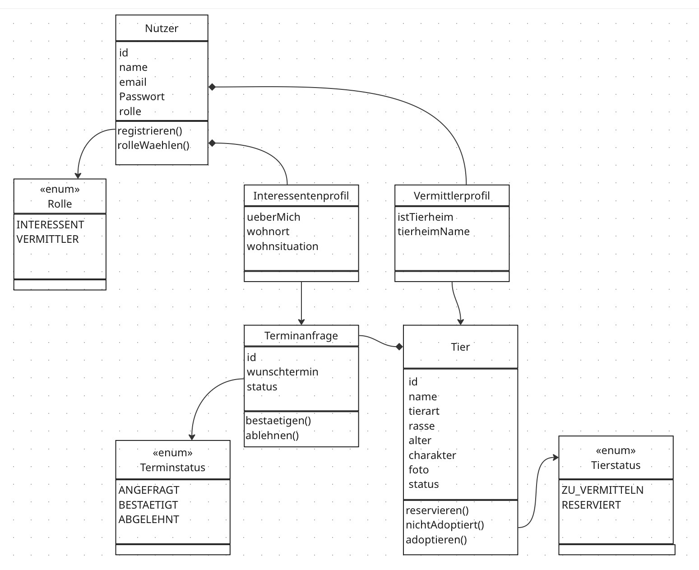

#  PetMatch (Übungsblatt 3 Systemarchitektur Ihres Projektes modellieren)

## Aufgabe 2:

## Klassendiagramm

## Von Events zum Modell

| Event (Miro)                                     | Im Modell                                                                                                                                                                     |
|--------------------------------------------------|-------------------------------------------------------------------------------------------------------------------------------------------------------------------------------|
| Nutzer hat sich registriert                      | `Nutzer.registrieren()`                                                                                                                                                       |
| Interessent hat Profil mit Daten gefüllt         | `Interessentenprofil` (ueberMich, wohnort, wohnsituation)                                                                                                                     |
| Tierprofil wurde erstellt                        | neues `Tier` mit Status `ZU_VERMITTELN`                                                                                                                                       |
| Termin wurde angefragt                           | neue `Terminanfrage` mit Status `ANGEFRAGT`                                                                                                                                   |
| Termin wurde bestätigt                           | `Terminanfrage.bestaetigen()`                                                                                                                                                 |
| Termin wurde abgelehnt                           | `Terminanfrage.ablehnen()`                                                                                                                                                    |
| Tier wurde reserviert und aus der Suche entfernt | `Tier.reservieren()` → Status `RESERVIERT`                                                                                                                                    |
| Tier wurde nicht adoptiert                       | `Tier.nichtAdoptiert()` → zurück zu `ZU_VERMITTELN`                                                                                                                           |
| Tier wurde adoptiert / Inserat wurde gelöscht    | `Tier.adoptieren()` → Tier und seine Terminanfragen werden gelöscht                                                                                                           |
| Termin hat stattgefunden                         | kein eigener Status nötig, weil die Kommunikation nicht im System stattfindet. Danach folgt „adoptiert“  --> löschen oder „nicht adoptiert“ --> wieder Status `ZU_VERMITTELN` |

## Entitäten, Werte und Aggregate

**Entitäten**
- `Nutzer`: wird registriert, wählt eine Rolle
- `Tier`: wird eingestellt, reserviert, adoptiert (gelöscht)
- `Terminanfrage`: wird angefragt, bestätigt oder abgelehnt

**Value Objects** 
- Beim Tier: `name`, `tierart`, `rasse`, `alter`, `charakter`, `foto`, `status` (`TierStatus`)
- Beim Nutzer: `name`, `email`, `passwort`, `rolle` (`Rolle`), `Interessentenprofil` (ueberMich, wohnort, wohnsituation), `Vermittlerprofil` (istTierheim, tierheimName)
- Bei der Terminanfrage: `wunschtermin`, `status` (`TerminStatus`)

**Aggregate** 
- Aggregat **Nutzer**: Root `Nutzer` mit Rolle und Profil
- Aggregat **Tier**: Root `Tier` mit seinen Eigenschaften und seinem Status
- Aggregat **Terminanfrage**: Root `Terminanfrage` mit Wunschtermin und Status.

## Aufgabe 3_Bounded Contexts

| Bounded Context | Verantwortung | Entity / Aggregat |
|---|---|---|
| Nutzerverwaltung | Registrierung, Rolle, Profil füllen | `Nutzer` mit Profil |
| Tierverwaltung | Tiere einstellen und Status verwalten | `Tier` |
| Terminvermittlung | Termine anfragen und Status verwalten | `Terminanfrage` |

## Aufgabe 4

### Nutzerverwaltung

**Nutzer** (Aggregat-Root)
- Attribute: id (Long), name (String), email (String), passwort (String), rolle (Rolle)
- Dazu je nach Rolle ein Profil:
    - Interessentenprofil: ueberMich, wohnort, wohnsituation (alles String)
    - Vermittlerprofil: istTierheim (boolean), tierheimName (String)
- Methoden:
    - registrieren(): erstellt den Nutzer
    - rolleWaehlen(): Rolle festlegen.

### Tierverwaltung

**Tier** (Aggregat-Root)
- Attribute: id (Long), nutzerId (Long), name, tierart, rasse, charakter, foto (alles String), alter (int), status (TierStatus)
- Methoden:
    - reservieren(): nur wenn das Tier zu vermitteln ist
    - nichtAdoptiert(): Tier ist wieder zu vermitteln
    - adoptieren(): Tier wird adopitiert --> Inserat wird gelöscht.

### Terminvermittlung

**Terminanfrage** (Aggregat-Root)
- Attribute: id (Long), tierId (Long), nutzerId (Long), wunschtermin (LocalDateTime), status (TerminStatus)
- Methoden:
    - bestaetigen(): Termin wird bestätigt, nur wenn noch verfügbar.
    - ablehnen(): Termin wird abgelehnt.

### Beziehungen

Die Aggregate kennen sich nur über ihre ID. Ein Tier merkt sich, wer es eingestellt hat (nutzerId). Eine Terminanfrage merkt sich das Tier (tierId) und den Interessenten (nutzerId).